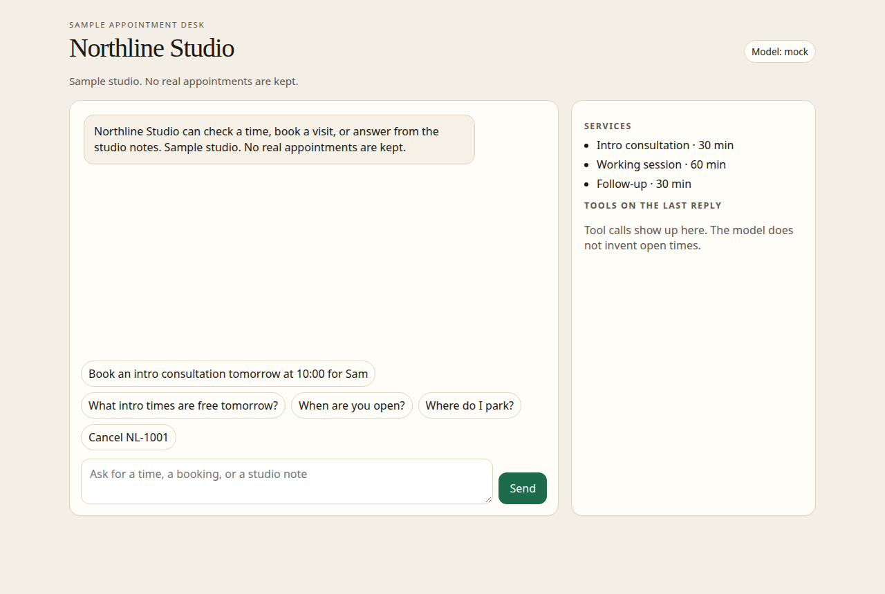
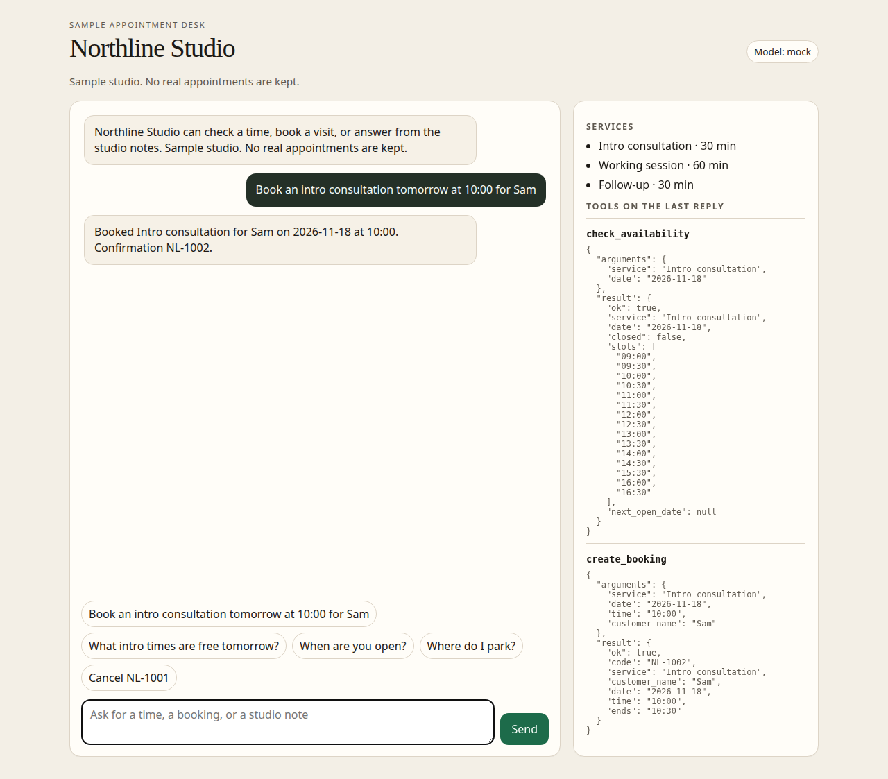
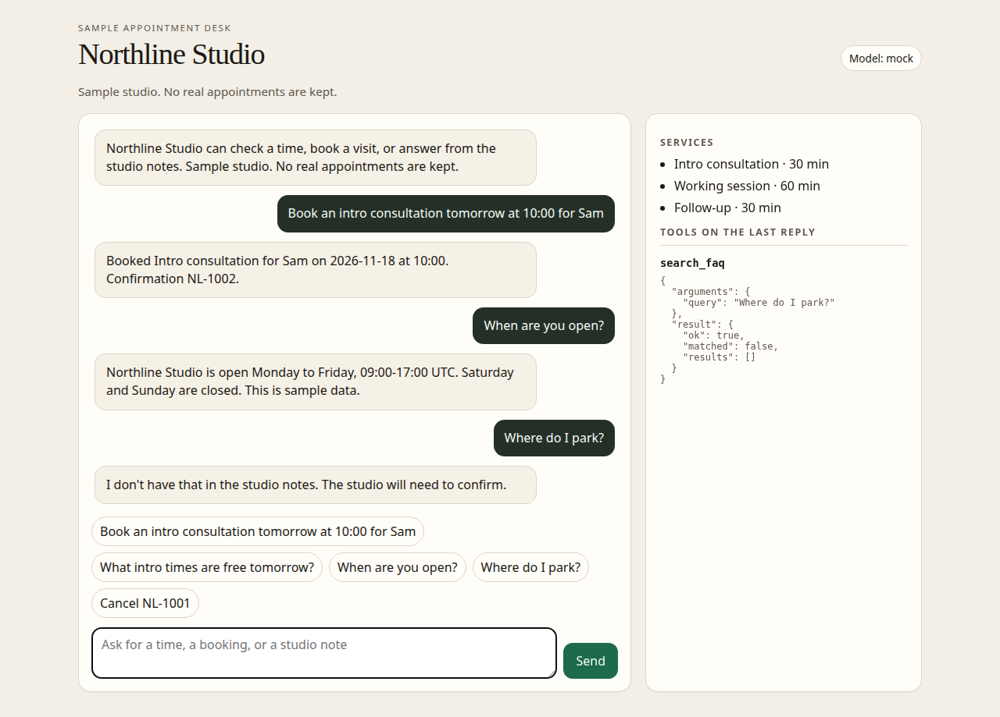
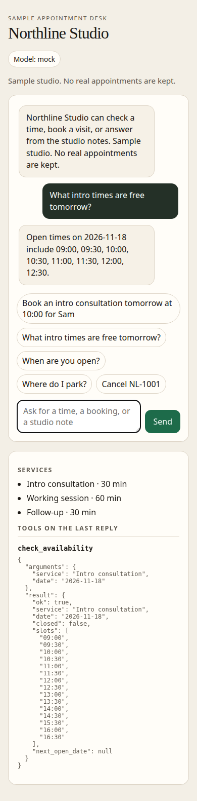
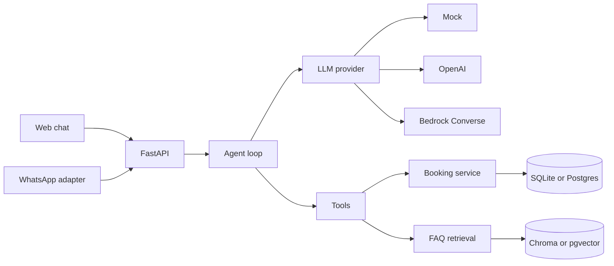

# Booking assistant

A small appointment desk for a fictional studio, Northline. The calendar lives in code. The model can check a time, save a booking, cancel one, or look up a studio note. It cannot invent a free slot or a fact that is not in the notes.

The studio, the prices, and every booking are sample data. Nothing here is a real business, and the default model makes no network call.

**Live demo:** not deployed. Put a URL here after you host it.

Shots below are from the local mock UI on 17 November 2026. "Tomorrow" in those shots is 18 November.









## Problem

A service desk loses bookings when nobody is there to answer, and a chat model will happily invent an open time. This app keeps three jobs in ordinary code:

- which slots are open
- saving and cancelling a booking
- which sentences exist in the studio notes

The model chooses a tool and reads the result. Tests run the same path with a deterministic mock, so they do not need an API key and they do not spend money.

## Architecture



The web UI and the optional WhatsApp webhook both call one conversation store. A provider is `mock`, `openai`, `bedrock`, or a comma-separated fallback such as `bedrock,mock`. An empty OpenAI key raises before any HTTP call. Bedrock is not constructed until that provider is actually selected and a turn needs it.

Embeddings default to a local hashed bag of tokens so retrieval works offline. Swap that for a hosted embedding model before you trust paraphrases. Chroma stores the vectors on disk. `VECTOR_BACKEND=pgvector` stores them in Postgres instead. FAQ text is re-indexed from `knowledge/` on startup, so a fresh disk still answers questions. Bookings are not. They live in `DATABASE_URL` and disappear with an ephemeral disk.

## Stack

Python 3.12, FastAPI, SQLAlchemy, Pydantic, Chroma, optional pgvector, the OpenAI SDK, and boto3 for Bedrock's Converse API. The UI is one static page. Docker Compose runs the mock app. A second compose file adds Postgres.

## Run it locally

No keys.

```bash
python3 -m venv .venv
source .venv/bin/activate
pip install -e ".[dev]"
uvicorn booking_agent.main:create_app --factory --host 0.0.0.0 --port 8000
```

Open http://127.0.0.1:8000 . The badge should say `Model: mock`.

`GET /health` returns the provider and the vector backend. It does not return keys. `GET /api/bookings` needs the header `X-Demo-Key` (default `demo` in `.env.example`). That header is a local latch, not authentication.

Docker, still on the mock provider:

```bash
docker compose up --build
```

Postgres and pgvector, still local, still mock:

```bash
docker compose -f docker-compose.yml -f docker-compose.postgres.yml --profile postgres up --build
```

The database password in that file is for the local container only.

Copy `.env.example` to `.env` before pointing `LLM_PROVIDER` at OpenAI or Bedrock. Those calls cost money. Confirm `BEDROCK_MODEL_ID` in the Bedrock console first. This repo's tests never make them.

## Tests and evals

```bash
pytest
ruff check . && ruff format --check .
mypy
```

`evals/cases.yaml` is the offline set: book a free slot, refuse a taken one, cancel, answer hours from the notes, abstain on parking, and greet without a tool. `tests/test_agent_loop.py` runs that file through the API with the clock frozen on Wednesday 18 November 2026 at 12:00 UTC, so "tomorrow" is a Thursday and does not depend on the day you run CI. The mock provider is a scripted desk clerk. It still goes through `check_availability` and `create_booking`, and the booking service is what accepts or rejects the slot.

A live-model eval is not in CI. Wording would move, and the call would be billed.

GitHub Actions runs Ruff, mypy, pytest, and gitleaks. The gitleaks step uses the CLI, which scans this private repo without the paid gitleaks GitHub Action.

## WhatsApp

The adapter is off unless `WHATSAPP_ENABLED=true`.

- `GET /api/whatsapp/webhook` answers the Meta subscribe handshake when the verify token matches.
- `POST` requires `X-Hub-Signature-256` over the raw body using `WHATSAPP_APP_SECRET`. An empty secret is a 403, not a warning.
- A message id is stored only after the reply is produced. A duplicate delivery does not book twice. A crash before that leaves the id retryable.
- With no access token the process does not call Graph. The HTTP body carries the reply so you can see it. The sender number is hashed into the session id and is not written into the reply log line.
- Text messages only. Media, templates, and voice are out of scope.

## Deploy

[docs/aws.md](docs/aws.md) compares a free Render web service with App Runner and Fargate, with the pricing pages named. `infra/apprunner.tf` is a reference. Do not apply it from this setup. Applying it creates billable resources. CI does not call AWS.

## Layout

| Path | What it is |
| --- | --- |
| `booking_agent/` | API, agent loop, providers, calendar, retrieval, WhatsApp |
| `knowledge/` | Sample studio and the notes the FAQ tool may quote |
| `static/` | Web chat |
| `evals/cases.yaml` | Offline cases |
| `infra/` | App Runner reference and a Postgres overlap constraint |
| `docs/aws.md` | Hosting notes and prices, with sources |

## License

MIT. Copyright 2026 Muhammad Ayaz.
